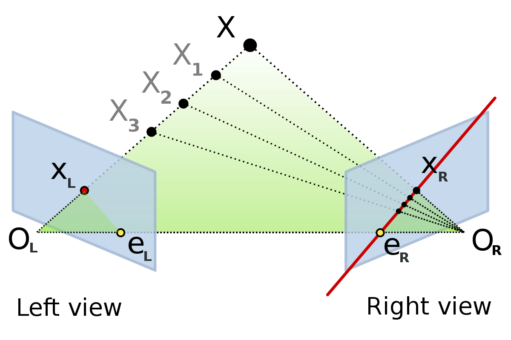

kornia.geometry.epipolar
========================

.. meta::
   :description: The kornia.geometry.epipolar module provides essential tools for working with epipolar geometry, crucial in tasks like Structure from Motion (SfM). It includes functions for computing the essential and fundamental matrices, decomposing them, and deriving relative camera motion. The module also offers various metrics for evaluating epipolar constraints, triangulating 3D points, and handling projection transformations. Additionally, it supports functions for normalizing points and transformations, calculating epipolar distances, and generating camera intrinsics.

.. currentmodule:: kornia.geometry.epipolar

Functions for two-view epipolar geometry, as used in Structure from Motion (SfM) and two-view pose estimation:
estimate fundamental and essential matrices, recover the relative pose, score correspondences and triangulate. The
first image's points come first, and both matrices satisfy :math:`x_2^\top F x_1 = 0`, ``F`` in pixels and ``E`` in
normalized camera coordinates :math:`K^{-1} [u, v, 1]^\top`. Camera poses are world-to-camera extrinsics, and the
relative motion ``(R, t)`` of camera 2 to camera 1 takes camera-1 coordinates to camera-2 coordinates,
:math:`X_2 = R X_1 + t`. See :ref:`two-view geometry <two-view-conventions>` for a comparison with OpenCV. For a
plane or a pure rotation use :doc:`homographies <geometry.homography>`, and with outliers
:class:`~kornia.geometry.ransac.RANSAC`.

Essential
---------

Estimate up to ten essential matrices from calibrated correspondences (:func:`find_essential`), convert from and to
other models (:func:`essential_from_fundamental`, :func:`essential_from_Rt`, :func:`project_to_essential`), and
recover the relative pose: the four candidates (:func:`motion_from_essential`) or the two rotations and the
translation that combine to them (:func:`decompose_essential_matrix`, :func:`decompose_essential_matrix_no_svd`), the
one with the points in front of both cameras (:func:`motion_from_essential_choose_solution`), or the motion between
two known poses (:func:`relative_camera_motion`).

.. autofunction:: find_essential
.. autofunction:: project_to_essential
.. autofunction:: essential_from_fundamental
.. autofunction:: essential_from_Rt
.. autofunction:: decompose_essential_matrix
.. autofunction:: decompose_essential_matrix_no_svd
.. autofunction:: motion_from_essential
.. autofunction:: motion_from_essential_choose_solution
.. autofunction:: relative_camera_motion

Fundamental
-----------

Estimate the fundamental matrix from pixel correspondences with the 8-point or 7-point algorithm
(:func:`find_fundamental`), convert from an essential matrix or two projection matrices
(:func:`fundamental_from_essential`, :func:`fundamental_from_projections`), compute epipolar lines and the nearest
points on them (:func:`compute_correspond_epilines`, :func:`get_closest_point_on_epipolar_line`,
:func:`get_perpendicular`), and normalize points and matrices for the estimators (:func:`normalize_points`,
:func:`normalize_transformation`).

.. autofunction:: find_fundamental
.. autofunction:: fundamental_from_essential
.. autofunction:: fundamental_from_projections
.. autofunction:: compute_correspond_epilines
.. autofunction:: normalize_points
.. autofunction:: normalize_transformation
.. autofunction:: get_perpendicular
.. autofunction:: get_closest_point_on_epipolar_line

Metrics
-------

Score correspondences against a fundamental matrix: the first-order geometric error (:func:`sampson_epipolar_distance`),
the summed squared distances of both points to their epipolar lines (:func:`symmetrical_epipolar_distance`), or the
distance in one image only (:func:`left_to_right_epipolar_distance` in image 2,
:func:`right_to_left_epipolar_distance` in image 1).

.. autofunction:: sampson_epipolar_distance
.. autofunction:: symmetrical_epipolar_distance
.. autofunction:: left_to_right_epipolar_distance
.. autofunction:: right_to_left_epipolar_distance

Projection
----------

Compose and decompose projection matrices ``P = K [R | t]`` (:func:`projection_from_KRt`,
:func:`KRt_from_projection`), get a canonical pair for a fundamental matrix (:func:`projections_from_fundamental`)
and the depth of points in a camera (:func:`depth_from_point`), and build camera matrices
(:func:`intrinsics_like`, :func:`scale_intrinsics`, :func:`random_intrinsics`).

.. autofunction:: projection_from_KRt
.. autofunction:: KRt_from_projection
.. autofunction:: depth_from_point
.. autofunction:: projections_from_fundamental
.. autofunction:: intrinsics_like
.. autofunction:: scale_intrinsics
.. autofunction:: random_intrinsics

Numeric
-------

The skew-symmetric matrix :math:`[x]_\times` of 3-vectors with any number of leading dimensions.

.. autofunction:: cross_product_matrix

Triangulation
-------------

Triangulate 3D points from two projection matrices and matched points (:func:`triangulate_points`), and generate a
random synthetic scene to test the estimators on (:func:`generate_scene`).

.. autofunction:: triangulate_points
.. autofunction:: generate_scene
